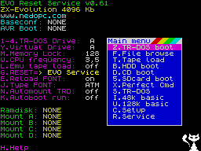

# Validation

Current installed candidate: **26102804**. Historical 26102800/26102801/26102802/26102803 evidence is retained below; use the current results section for this iteration.

Run from the core root (`forge/cores/zx-evo-base/`):

```sh
python3 tools/bootstrap.py sources
python3 tools/bootstrap.py binaries
python3 tools/forge.py prepare
python3 ../../../tools/check_board.py --project . --ucf build/baseconf/karabas_go.ucf
python3 tools/forge.py elaborate
python3 tools/forge.py test --suite all
python3 tools/forge.py lint
```

The complete board elaborates, the 183-ball PCB net audit passes, and Yosys reports zero structural check problems after process conversion/flattening/tristate resolution. The following self-checking tests passed again on 2026-10-28 after the GS memory-service change:

| Test | Evidence |
|---|---|
| SRAM | 200 random word addresses, both byte masks, top address, read/write turnaround |
| Shared SDRAM | ROM/GS separation, upper/lower bytes, end addresses, simultaneous requests, refresh, invalid upload guard, ROM page changes during/after a pending read, exactly one queued write per three-fast-clock loader pulse |
| CPU at 3.5 / 7 / 14 MHz | ROM31 fetch; ATM paging; RAM2 and RAM255:FFFF; CMOS single updates; BD page/breakpoint readback including high-address mirrors; physical-drive mask; Nemo/divIDE byte sequences; Firefly track/sector/system registers and side latch; branch and border |
| GS timing | Real GS/T80 four-channel ISR versus zero-wait reference: 74/74 and 75/75 serviced interrupts, with/without ROM contention; normal and approximate routed-delay cases; matching stereo samples |
| MCU/HID at 16 MHz SPI | PS/2 make/break sequence, FIFO drain/clear, USB matrix press/release, both joystick ports, OSD-selectable mappings, mouse deltas/wheel/buttons, OSD command delivery |
| Board video ownership | Actual MCU SPI control releases FPGA RGB/sync outputs, enables FT output and selects FT clock; clearing control restores FPGA ownership |

Logs and compiler warnings are in `build/baseconf/`. Testbenches call `$fatal` on errors and require explicit PASS markers. The CPU test deposits a tiny diagnostic into SDRAM before releasing reset; it does **not** claim a stock BaseConf BIOS boot. ROM upload/storage is tested separately.

The FPGA source list includes neither the GHDL-generated Verilog nor the behavioral clock models. ISE uses original VHDL CPU/HID sources.

## Stock ROM observation

```sh
python3 tools/forge.py bios --simulator verilator --milliseconds 2500 --trace --require-menu
python3 tools/bios_inspect.py --page 5 --require-menu
```

The board harness uses the unmodified stock BaseConf and GS ROMs, actual MCU/HID/RTC logic, a deterministic power-on memory pattern, and an erased EEPROM initialized through 16 MHz SPI. CF and SD are absent. The 1.5-second run reached the decompressed main-menu entry at 6000 and proceeded into the stock Nemo driver timeout loop while checking the absent CF card. The 3.5-second run displayed the main menu and `ZX-Evolution 4096 Kb`. The first millisecond also runs in four-state Icarus with matching progress. The test-only SRAM model in Verilator uses ideal OE switching with a 10 ns address-to-data delay; the Icarus model retains delayed tristate drivers.

`--require-menu` checks the ROM SHA-256 and stable screen regions recorded after visual review in `config/bios-menu-signature.json`. It covers the BIOS/version banner, 4096 KB label and initial menu, excluding clock/animation/device-status regions. `bios-result.json` records the simulator, observation duration, build/testbench hashes and output hashes. A failed or unfinished run is not a passing menu result.

The final RTL passed this check after **2500 ms** of simulated execution. The [retained screen](evidence/stock-bios-menu.png) and [run provenance](evidence/stock-bios-menu.json) are stored with the documentation. The earlier 500 ms snapshot correctly fails the menu signature check.



`bios_inspect.py` renders SRAM bitmap/attributes with standard Spectrum colors. Its image is not a VGA output capture and cannot establish extended graphics or palette correctness.

## Preliminary resource estimate

`python3 tools/forge.py resources` maps the translated RTL with Yosys's Spartan-6 flow and runs `check -assert`. The historical 2026-10-27 estimate was 9,788 LUT1–LUT6 cells, 6,336 flip-flops, 16 latches, 6 DSP48A1 blocks, 5 RAMB16BWER blocks and 3 RAMB8BWER blocks, plus distributed RAM/shift registers and clock/I/O cells. Full counts are in `build/baseconf/resource-stat.json` and warnings in `resources.log`.

This estimate uses GHDL-exported CPU/HID logic. Actual ISE inference, packing, routing, utilization and timing may differ; the estimate is not a successful implementation or a fit certificate.

## Actual ISE implementation — build 26102800

`python3 tools/forge.py ise --docker` completed XST, NGDBuild, MAP, PAR, TRCE and BitGen. `python3 tools/forge.py package` validated provenance and timing before making `baseconf.kg1`. Independent parsing compared the embedded bitstream and both addressed ROM payloads with their inputs and checked identity/build and ten OSD entries.

Final fit: 9,836/15,032 LUTs (65%), 5,701/30,064 slice registers (18%), 3,370/3,758 occupied slices (89%), zero latches, 4 DSP48A1, 6 RAMB16BWER and 6 RAMB8BWER. Routing is complete. The [full timing report](evidence/ise-26102800-timing.txt), [utilization report](evidence/ise-26102800-utilization.txt) and [artifact hashes](evidence/ise-26102800.json) are retained.

TRCE reports zero setup/hold errors and all declared constraints met. Selected worst margins: bus period 4.287 ns, SRAM output 1.938 ns, SDRAM output 0.989 ns, SDRAM input 1.893 ns, MCU MOSI 12.932 ns and MCU MISO 4.847 ns. The SPI offsets model a 16 ns MOSI setup/hold window and 25 ns falling-edge MISO output allowance at 16 MHz.

The review removed a real fabric-generated CPU latch clock. Remaining unconstrained sections include CF/SD/FDC external pin paths, VGA/audio/forwarded-clock outputs, MCU chip-select/burst-select inputs and FT pass-through paths. The SRAM/SDRAM constraints are FPGA datapath budgets, not complete PCB setup/hold models. Cross-domain datapath limits alone do not prove metastability or handshake correctness. Thus a passing report supports an experimental hardware candidate, not full peripheral/electrical certification.

The physical board's USB firmware accepted a core-list command, exposed SD1, and listed the package after a verified non-overwriting copy and clean eject. This establishes transfer and package-header recognition, not FPGA startup. Existing root `.kg1` and `karabas.ini` hashes were unchanged. SD2 and CF were not written.

## GS correction — build 26102801

The [GS comparison](gs-timing.md) reproduces lost sample service with the original 28 MHz memory controller. The new 84 MHz service passes all adapter/CPU/HID/board/GS regressions and structural lint. Both read-delay cases reach 74/74 and 75/75 reference interrupts, with identical stereo samples. [Regression log](evidence/gs-26102801-regressions.txt), [baseline](evidence/gs-26102800-baseline.txt), [test provenance](evidence/gs-26102801.json).

The final 2500 ms stock-ROM check passes the menu/4096 KB signature: [screen](evidence/stock-bios-menu-26102801.png), [provenance](evidence/stock-bios-menu-26102801.json). BIOS and ISE share manifest `43c24774c79b80aca8beaff2eb6f14c577c3082e5ded9c446d03682e7ce38f63`.

ISE fits 9,828 LUTs, 5,737 slice registers, 3,352 occupied slices (89%), zero latches, 4 DSPs, 6 RAMB16 and 6 RAMB8. All declared constraints pass with zero timing errors; minimum reported margin is 0.321 ns for the 4 ns SDRAM input-path budget. The 84 MHz period margin is 1.051 ns and the SDRAM output budget margin is 1.410 ns. This remains partial external timing coverage; the input budget and capture-phase rationale are explained in the GS diagnosis. [Timing](evidence/ise-26102801-timing.txt), [utilization](evidence/ise-26102801-utilization.txt), [hashes](evidence/ise-26102801.json).

The generic package SHA-256 is `abef39ec1b2db0e662879ffb18d8c4eebd871d8cb770fa8f49b6b9674f571df9`. The installed copy preserves the user's saved OSD block (including 60 Hz), so its SHA-256 is `b3f3ffc0cac1dc70ee7c6c7e490e3f26c323540e0a17da66bbb14c62e125639b`. FPGA/ROM bytes and all other package bytes are identical. The previous card copy differed from 26102800 only at byte 517 (50 → 60 Hz). It was backed up before replacement. Other root files passed hash checks; SD1 was cleanly ejected and the [live firmware list](evidence/board-core-list-26102801.txt) confirms 26102801. [Transfer evidence](evidence/gs-sd1-transfer-26102801.json). Physical listening/boot acceptance for the new candidate remains pending.

## Candidate 26102802: actual intro, BRAM and OSD

All earlier adapter/CPU/GS/HID suites pass with the revised storage; storage checks now cover 63 RAM pages with eight marks per page and the BRAM/SDRAM boundary. Final expanded board and OSD suites were run separately after being added. The board test exercises real SPI switch/reset commands. The OSD test observes actual pixels at 50/60/50 Hz and fits all 416 scan-doubled menu lines inside the visible area. Structural lint passes. [Regression log](evidence/gs-26102802-regressions.txt), [board controls](evidence/board-controls-26102802.txt), [OSD pixels](evidence/osd-26102802.txt).

The real GS ROM cold and F3 warm checks report 62 usable pages for both controllers; exact MOD upload passes. Intro playback shows 299 underruns by 9.23 seconds with 26102801 and zero through 13.29 seconds with 26102802. Matching ten-second WAVs are complete excerpts from intentionally stopped longer controller runs. The zero-wait reference completes 30 seconds with zero underruns. These are simulated GS samples before the board audio mixer/DAC. The physical 1Mb error is unreproduced. [Audio evidence and limits](gs-audio.md).

Stock BIOS reaches the menu and 4096 KB signature at 2500 ms. Its manifest matches ISE. ISE reports zero declared timing errors, no latches, 9,905 LUTs, 5,807 slice registers, 3,351 occupied slices, 38 RAMB16 and 6 RAMB8. External timing coverage remains provisional. [BIOS](evidence/stock-bios-menu-26102802.json), [timing](evidence/ise-26102802-timing.txt), [utilization](evidence/ise-26102802-utilization.txt), [hashes](evidence/ise-26102802.json).

The generic package SHA-256 is `ca6a093b40adaadaadabf48e559d9f88bc9e0a1bf787c3a763e4a777c92c65f5`; installed with preserved Covox-off/60 Hz settings it is `90c28ae5c35705d66b5c14f396de39fff5ec7889b3a82a3f16c48ff8d256001e`. FPGA/ROM payloads and card readback pass comparison; other root files are unchanged; SD1 was cleanly ejected. [Firmware lists 26102802](evidence/board-core-list-26102802.txt), [transfer evidence](evidence/gs-sd1-transfer-26102802.json). Physical audio/OSD acceptance remains pending.

## Candidate 26102803: shortcut isolation

The user confirms 26102802 GS audio and OSD are good and that 0+reset restored ERS startup. 26102803 preserves those GS/audio/storage/OSD inputs and adds reserved Win/Menu-shortcut filtering before both matrix and PS/2 paths. [Source comparison](evidence/shortcut-source-comparison-26102803.json).

All regressions and structural lint pass. The new test covers nine reserved keys, six HID slots, both Win keys, key/modifier release ordering, repeat suppression, normal makes/breaks, extended prefixes and Pause. The MCU/HID integration checks that Menu+G produces no G matrix bit or buffered PS/2 G, while plain G still works. [Filter](evidence/shortcut-filter-26102803.txt), [MCU/HID](evidence/shortcut-hid-26102803.txt), [full regression log](evidence/shortcut-regressions-26102803.txt).

The stock BIOS reaches ERS and the 4096 KB signature after 2500 ms. BIOS and ISE share one input manifest. ISE reports zero declared timing errors, no latches, 10,388 LUTs, 6,192 slice registers, 3,411 occupied slices, 38 RAMB16 and 6 RAMB8. [BIOS](evidence/stock-bios-menu-26102803.json), [timing](evidence/ise-26102803-timing.txt), [utilization](evidence/ise-26102803-utilization.txt), [hashes](evidence/ise-26102803.json).

Generic package SHA-256: `3aea0a298e46a9890068afc6672c72bfd39a8cb94aac2f4c82ab5b38b74928be`. Installed with preserved 60 Hz/Covox-off settings: `7bc04900b327609c72390e843a754636754a1a9b2766ee8904f537b5e6ce84b0`. Payloads and SD1 readback pass; other root files are unchanged; clean eject completed. [Firmware list](evidence/board-core-list-26102803.txt), [transfer](evidence/shortcut-sd1-transfer-26102803.json). The user subsequently reports “all works” after the requested shortcut/ERS check; current-iteration physical acceptance is recorded in [board acceptance](evidence/board-acceptance-26102803.json).

## Candidate 26102804: SEGA joystick keyboard mode

Both OSD joystick selectors append SEGA as option 6, preserving options 0–5. The adapted HID parser maps Up/Down/Left/Right to Q/A/O/P, A/B/C to Z/X/C, X/Y/Z to S/D/F, START to 0 and MODE to 9. MCU/HID regression tests cover each control on each port, releases, chords, all and combined keyboard rows, live mode switches, both ports together, keyboard coexistence and mixed SEGA/Kempston operation. Full regressions and structural lint pass. [HID results](evidence/sega-hid-26102804.txt), [full results](evidence/sega-regressions-26102804.txt), [source comparison](evidence/sega-source-comparison-26102804.json).

The 2500 ms stock-BIOS simulation verifies ERS and 4096 KB. BIOS/ISE input manifests agree. ISE reports zero declared timing errors, no latches, 10,305 LUTs, 6,204 slice registers, 3,355 occupied slices, 38 RAMB16 and 6 RAMB8. [BIOS](evidence/stock-bios-menu-26102804.json), [timing](evidence/ise-26102804-timing.txt), [utilization](evidence/ise-26102804-utilization.txt), [hashes](evidence/ise-26102804.json).

Independent package parsing checks all ten OSD entries, including seven options ending in SEGA for both joystick selectors, and FPGA/ROM payload identity. [Package evidence](evidence/sega-package-26102804.json). Generic SHA-256: `9da320b0c3fcf60679e95f8ce8ea533d4d953c49779e18b64ef58f183fb9bd00`; installed with current saved settings: `d5675fc72d33e35b1bc63dcfb7b47a7c559b70bb8fb53eba65e148b6c2fda1a1`. SD1 readback and other root-file hashes pass; clean eject completed. [Transfer](evidence/sega-sd1-transfer-26102804.json). Physical pad and game redefine-keys checks remain pending. [User guide and firmware shortcuts](joysticks.md).

## Remaining acceptance

1. Complete the remaining external-interface/CDC review and physical measurements; rerun implementation if constraints or RTL change. Current ISE implementation is passing within its stated coverage.
2. Independently check B4 schematic pin locations, especially SDRAM clock polarity, FDC buffer polarity and CF bus direction.
3. Repeat physical boot/reset with each new candidate. ERS 4096 KB and Dune rendering have been observed on 26102800; the corrected GS candidate needs the same checks.
4. Test keyboard matrix and PS/2 buffer, shifted keys, key repeats, USB mouse wrapping/wheel/buttons, both joystick mappings and Win+Esc OSD. Test pause, NMI and both reset actions.
5. On a test CF card, test identification, directories, reads, then writes/readback. Check both Nemo byte-access sequences. Record card model and timing.
6. On disposable/test media, test floppy restore/seek, both drives/sides, sector reads/writes, write protect, CRC and lost-data handling. Compare file checksums before/after.
7. Show test patterns in all extended graphics modes and both rasters; verify font writes and palette changes.
8. Check both AY channels/chips, FM tones, GS memory test and sustained music; measure effective GS speed and audio underruns before claiming Dune compatibility.
9. Run the supplied Dune media with 14 MHz turbo; record title screen, menu, a mission, input and music. The reference game README describes mounting `dune.trd`, keeping `DUNE.DAT` at SD root and running TR-DOS. BaseConf's original AVR-provided virtual-disk services are not present in this port; a real floppy/Gotek TRD path or an additional mount implementation may be needed. Do not claim that the original “mount A:” firmware workflow is automatically available.

ISE implementation and SD1 package transfer have been performed. The supplied photos establish physical ERS startup with 4096 KB and Dune rendering. The user reports that 60 Hz fixes monitor cropping and that GS audio is slow; full gameplay and corrected-audio acceptance remain pending. See [GS diagnosis](gs-timing.md).

## Mini / Mini G build 26102805

Both target implementations pass normal and core-mode timing with zero errors. Each final manifest matches BIOS/ERS/4096 KB (2500 ms), real video/OSD and HDMI transport evidence, and independent package checks. GPIO assignment comparison matches the supplied target references; it is not a schematic/PCB audit. Machine simulations use an HDMI sink; the separate HDMI test uses real logic and vendor clock models. Full Mini regressions pass, and GO regressions plus byte-identical regenerated GO inputs establish preservation of 26102804. [Detailed results, artifacts and hardware limits](mini-cores.md).


## Repository relocation validation

The Forge reorganization was checked in fresh `build/reorganization-check/go`, `mini` and `minig` directories. Generated implementation manifests and regenerated package bytes exactly match their pre-move versions. Existing ISE implementation outputs/provenance were reused after that comparison; place-and-route was not repeated.

All three targets passed elaboration, full regressions, lint and 2500 ms stock-BIOS menu verification. Mini and Mini G additionally passed actual raster/OSD and HDMI transport checks. The selected core build mount was exercised through Docker XST and vendor-model extraction. Shared/core path tests, dependency/resource checks, B4 pin auditing and Dune media staging passed. See [machine-readable results](evidence/reorganization.json).

From the Forge root, run the tooling checks with:

```sh
python3 -m unittest discover -s tests -v
python3 -m unittest discover -s forge/cores/zx-evo-base/tests -p 'test_*.py' -v
```


## AY regression

`python3 tools/forge.py test --suite ay` runs real CPU PSG register/readback and pure-tone/mixer checks at all three CPU speeds in both AY and YM modes, using Verilator. It is included in `all`. GO/Mini/Mini G passed all 18 cases during the [AY noise investigation](ay-audio.md). This test isolates AY with GS reset and does not certify physical noise, arbitrary music/envelopes or simultaneous audio sources.

## Reset controls — 26102806

Packages: [GO kg1](../build/releases/reset-26102806/baseconf.kg1), [Mini kg2](../build/releases/reset-26102806/baseconf.kg2), [Mini G kg3](../build/releases/reset-26102806/baseconf.kg3). [Checksums](../build/releases/reset-26102806/SHA256SUMS), [validation evidence](evidence/reset-26102806.json), [source and implementation snapshots](../build/releases/reset-26102806/).

All three targets pass the full HDL suites (including GS/AY), structural lint, ten stock-ROM reset selections each, 2500 ms normal BIOS startup with the pinned ERS/4096 KB screen signature, ISE implementation and declared timing, and independent package validation of FPGA/ROM payloads and all nine menu entries/hotkeys. Mini and Mini G also pass real video/HDMI tests and both FT/core timing reports. A fresh prepare reproduces each implemented manifest exactly. The BIOS reset tests initialize the normal font/microcode images and execute the unmodified ROM; they do not substitute a diagnostic ROM for its boot choices.

| Board | Occupied slices / 3758 | LUTs | Timing errors |
|---|---:|---:|---:|
| GO | 3382 | 10177 | 0 |
| Mini | 3683 | 11831 | 0 in both modes |
| Mini G | 3637 | 11695 | 0 in both modes |

Build outputs are isolated in `build/reset-26102806/<board>/`. Earlier releases and the installed GO 26102804 package are preserved. No board/media/MCU transfer was performed. These results establish digital reset/ROM dispatch and declared FPGA timing; physical keyboard, reset and GS restart acceptance remain pending. The Mini/Mini G AY noise report is not claimed fixed.
